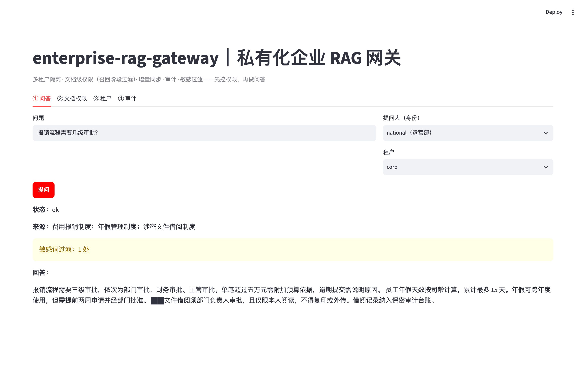
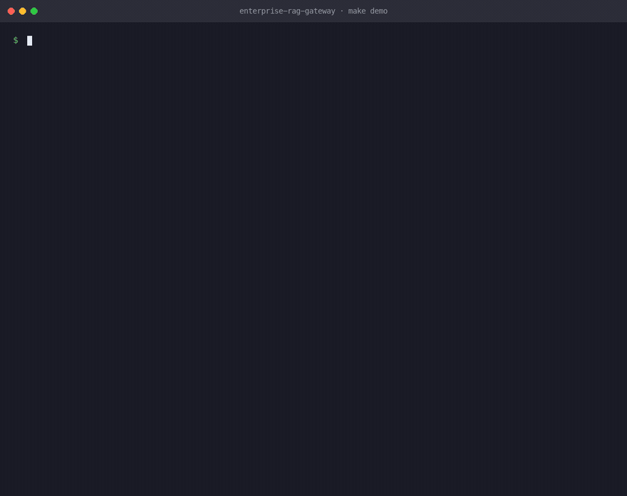
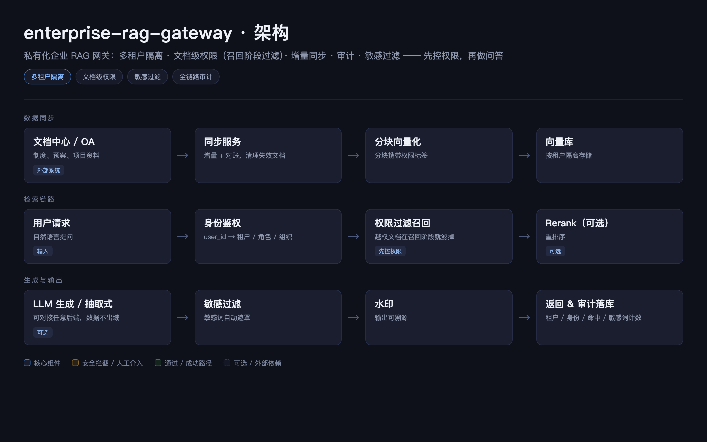
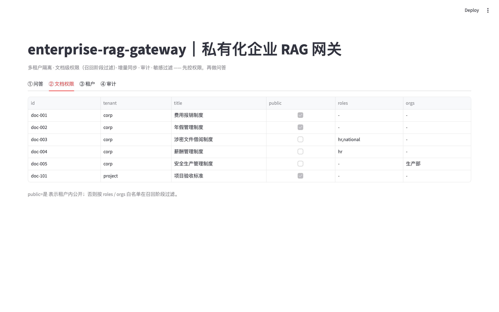
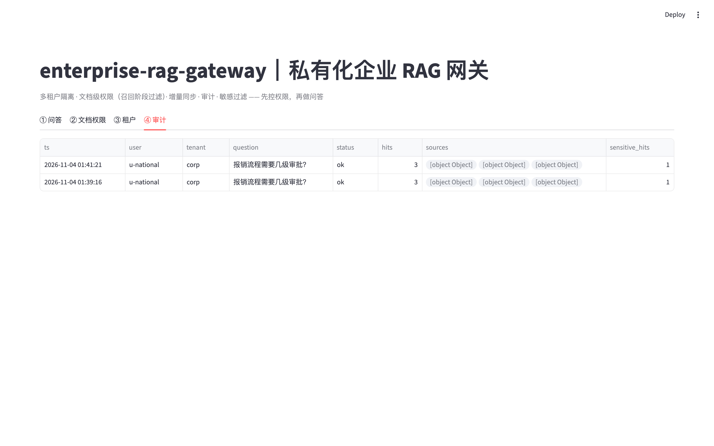
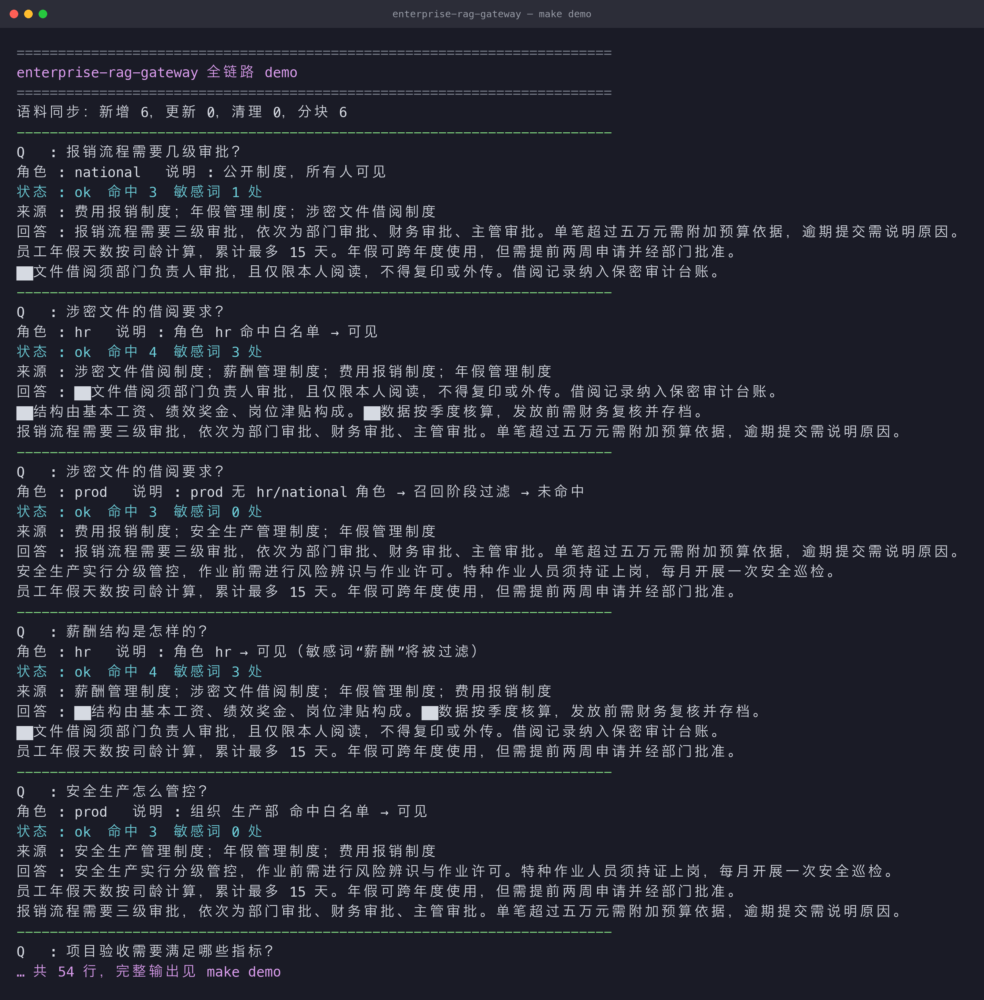

# enterprise-rag-gateway

[](https://www.python.org/) [](#license) []() []() [](https://github.com/fenrir1111/enterprise-rag-gateway/actions/workflows/ci.yml)

> 私有化企业 RAG 网关｜带细粒度权限、多租户、审计、敏感过滤的 B 端知识库检索网关

> 属于【enterprise-ai-stack】B端私有化 AI 交付底座合集
> 👉 总入口：https://github.com/fenrir1111/enterprise-ai-stack

## 🚀 运行效果（真实截图）

提问「报销流程需要几级审批？」→ 命中文档、敏感词自动 `██` 遮罩，**越权文档在召回阶段就被过滤，根本不进上下文**：



## 🎬 一条命令跑通（真实终端录制）

`make demo` 一条命令跑通全链路（**真实终端录制**，非模拟）：语料同步 → 检索 → 敏感词遮罩 → 召回阶段权限过滤 → 审计：



## 一句话简介
面向政企内网知识库交付，解决普通 RAG「缺少租户隔离、文档权限、审计留痕、数据合规」的痛点；
对接 OA / 文件中心增量同步，可对接任意 LLM 后端（OneAPI / LiteLLM），**数据不出域**。
设计原则：**先控权限，再做问答**。

## 适用场景
央企、国企私有化知识库、内部制度、安全生产文档、项目资料问答，满足等保、审计要求。

## 核心能力
1. **多租户隔离**，租户独立向量空间，数据互不干扰。
2. **文档级细粒度权限标签**：组织 / 角色白名单，**在召回阶段过滤**（越权片段不进上下文）。
3. **增量文档 ingestion + 全量同步兜底对账**（内容校验和判定新增/更新/删除）。
4. **检索 + 重排链路**（重排可开关，低算力模式友好）。
5. **全链路审计日志**：查询人、租户、提问、命中文档、返回、时间。
6. **敏感词过滤、回答水印、导出管控**，拒绝无命中时的编造回答。
7. **Prompt 版本管理**（可租户独立配置），容器化一键离线部署。

## 架构简图



<details>
<summary>文本版架构简图</summary>

```
文档中心/OA → 同步服务(增量+对账) → 分块向量化(带权限标签) → 向量库(租户隔离)
用户请求 → 身份鉴权 → 权限过滤召回 → Rerank(可选) → LLM生成(可选)/抽取式
        → 敏感过滤 → 水印 → 返回 & 审计落库
```

</details>


## 快速启动
### 方式一：uv（推荐，本地）
```bash
uv venv .venv
uv pip install --python .venv/bin/python -r requirements.txt
uv pip install --python .venv/bin/python -e .

# 跑全链路 demo（租户隔离 + 文档权限 + 同步 + 审计，无需起服务）
.venv/bin/python -m rag_gateway.demo

# 起服务
.venv/bin/python -m uvicorn rag_gateway.main:app --host 0.0.0.0 --port 8000
# 交互式文档: http://127.0.0.1:8000/docs
```
或用 `make` 快捷命令：`make demo` / `make run` / `make test` / `make ui`。

### 方式二：Docker
```bash
docker compose up -d --build
curl http://127.0.0.1:8000/health
```

### 调用示例
```bash
# national 角色查涉密制度（hr/national 白名单内 → 可见）
curl -s localhost:8000/query -H 'Content-Type: application/json' \
  -d '{"question":"涉密文件的借阅要求？","user_id":"u-national","tenant_id":"corp","roles":["national"]}'

# 生产部用户查同一文档（无 hr/national 角色 → 召回阶段过滤 → 未命中）
curl -s localhost:8000/query -H 'Content-Type: application/json' \
  -d '{"question":"涉密文件的借阅要求？","user_id":"u-prod","tenant_id":"corp","org":"生产部"}'

# 全量同步语料（增量 + 对账）
curl -s localhost:8000/sync -H 'Content-Type: application/json' \
  -d '{"documents":[{"id":"doc-900","tenant_id":"corp","title":"差旅制度","content":"住宿上限500元/晚","allowed_roles":[],"allowed_orgs":[]}]}'
```

## 真实运行效果（`make demo` 真实输出，节选）

> 想看**动画版**（真实终端逐行录制）见文首「🎬 一条命令跑通」。

```text
Q: 涉密文件的借阅要求？    角色: hr（白名单内）
命中: 涉密文件借阅制度 等 4 篇    敏感词: 3 处
回答: ██文件借阅须部门负责人审批… ██结构由基本工资…（敏感词遮罩）

Q: 涉密文件的借阅要求？    角色: prod（无 hr/national）
命中: 费用报销制度；安全生产管理制度；年假管理制度
→ 涉密制度在「召回阶段」被权限过滤，越权片段根本不进上下文
```
**先控权限、再做问答**：租户隔离 + 文档级权限在召回阶段生效，敏感词自动遮罩、无命中不编造。

## 系统实拍（真实运行截图）

以下截图均为**本仓库真实运行**产出（`make ui` 起控制台 + `make demo` 跑全链路），未经修饰。

### 1. 问答 · 敏感词自动遮罩

提问「报销流程需要几级审批？」，身份选 `national（运营部）`——注意回答里 `██文件借阅…` 是**敏感词被遮罩**，不是乱码（见文首「🚀 运行效果」）：

### 2. 文档权限 · 谁能看哪篇文档

每篇文档的 `public` / `allowed_roles` / `allowed_orgs` 白名单一目了然，**越权文档在召回阶段就被过滤，根本不进上下文**：



### 3. 审计日志

每次问答的租户、身份、命中文档、敏感词计数全部留痕：



### 4. `make demo` 终端输出

```text
Q   : 涉密文件的借阅要求？
角色 : hr   说明 : 角色 hr 命中白名单 → 可见
状态 : ok  命中 4  敏感词 3 处
回答 : ██文件借阅须部门负责人审批，且仅限本人阅读，不得复印或外传。…
```



## 核心接口
| 方法 | 路径 | 说明 |
|---|---|---|
| POST | `/query` | 问答（带身份：`roles`/`org`，用于权限过滤 + 审计） |
| POST | `/sync` | 全量同步语料（增量 + 对账） |
| GET | `/documents` | 文档列表（含权限标签，`?tenant_id=`） |
| GET | `/tenants` | 租户列表 |
| GET | `/audit` | 审计日志（`?limit=`） |
| GET | `/health` | 健康检查 |

## 接入你的真实系统
- **对接 OA / 文件中心**：写适配器拉取文档列表 + 内容 + 权限元数据，封装成 `Document` 调 `sync_corpus`，示例见 [`examples/sync_adapter_example.py`](examples/sync_adapter_example.py)。
- **接真实向量库**：把 `embedding` 接口替换为真实向量模型、`retrieval` 换成 pgvector 查询即可（接口不变）。
- **接 LLM**：配置 `LLM_ENABLED=true` + `LLM_API_BASE/KEY`（兼容 LiteLLM/OneAPI）。

## CI 与质量门禁

每次 push / PR 自动跑 [GitHub Actions](https://github.com/fenrir1111/enterprise-rag-gateway/actions/workflows/ci.yml)（Python 3.10 + 3.12 双版本矩阵）：

| 环节 | 检查内容 |
|---|---|
| 单元测试 | `pytest` 全量（含 Streamlit 控制台冒烟，捕获脚本被当独立模块执行时的 ImportError） |
| demo 冒烟 | `python -m rag_gateway.demo` 全链路跑通，退出码必须为 0 |
| FastAPI 冒烟 | 起 `uvicorn` 并请求 `/health`，30s 内未就绪即失败 |
| Streamlit 冒烟 | 起控制台并请求 `/_stcore/health`，30s 内未就绪即失败 |

> 其中 `tests/test_streamlit_app.py` 用 Streamlit 官方 `AppTest` **真正执行一遍页面脚本**：
> Streamlit 是把 `streamlit_app.py` 当独立脚本跑的（没有 `__package__`），
> 一旦脚本里用了相对导入就会直接 `ImportError`，但页面仍返回 HTTP 200 —— 只有真跑一遍才发现得了。

本地复现：

```bash
make test    # 单元测试 + 控制台冒烟
make demo    # 全链路 demo
```

## 设计原则
- **召回阶段过滤权限**，而非回答后过滤：无权限 chunk 不进上下文，从源头截断泄露。
- **确定性优先**：默认抽取式回答 + 确定性哈希向量，离线可跑、可复现、可单测；LLM 为可选增强。
- **叠加不替代**：作为上层知识库网关，**不替代企业 IAM 与等保体系**，依赖外部身份源同步角色。

## 已知局限（非常重要）
1. **不提供完整 IAM**，只做权限标签映射，依赖外部身份源同步角色/组织。
2. 不支持亿级超大文档库，面向企业内部知识库（十万级以内）。
3. 重排消耗算力，低配置环境建议关闭 `rerank`。
4. 敏感词过滤是内置规则库，需客户补充行业词表。
5. 确定性哈希向量（POC 零依赖）语义能力有限，生产应替换真实向量模型；内存向量检索为 POC 量级，生产接 pgvector。

> 详见 [`docs/limitation.md`](docs/limitation.md)。

## 迭代计划
- v0.1：租户、文档权限、审计、基础问答（本仓库当前）
- v0.2：OA / 文件中心适配器、增量同步
- v0.3：溯源引用、水印、导出管控
- v0.4：对接 enterprise-ai-eval-harness 自动评测 RAG 效果

## 适合人群
私有化大模型交付、FDE、政企知识库项目。

## 参与共建
欢迎提交 Issue（反馈 bug、补充行业语料/敏感词表）、PR（适配向量库、OA 适配器）。有效贡献在 README 致谢栏署名。
详细流程见 [CONTRIBUTING.md](CONTRIBUTING.md)。

## License
MIT License，可自由使用、二次修改、商用；当前为 v0 版本，生产使用请自行评估风险。
