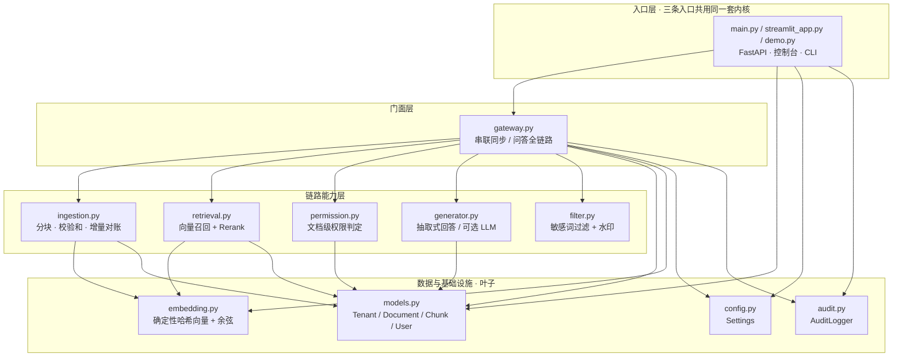

# 架构｜enterprise-rag-gateway

## 总体链路
```
文档中心 / OA ─┐
               ├→ 同步服务（增量 + 全量对账）→ 分块 + 向量化（带权限标签）→ 向量库（租户隔离）
用户请求 ─────┘
用户请求 → 身份鉴权（外部 IAM 同步角色/组织）→ 租户内召回
        → 召回阶段权限过滤（越权片段不进上下文）→ Rerank（可选）
        → LLM 生成（可选）/ 抽取式回答 → 敏感词过滤 → 水印 → 返回 & 审计落库
```

## 模块划分
| 模块 | 职责 |
|---|---|
| `models` | Tenant / Document / Chunk / User 数据模型 |
| `embedding` | 确定性哈希向量（POC 零依赖）+ 余弦相似度 |
| `permission` | 文档级权限判定（角色 / 组织白名单，召回阶段过滤） |
| `ingestion` | 分块、校验和、增量同步判定、全量对账 |
| `retrieval` | 向量召回 + 词重叠 Rerank |
| `generator` | 抽取式回答（兜底）/ LLM 生成（可选 litellm） |
| `filter` | 敏感词过滤 + 回答水印 |
| `audit` | 全链路审计（JSONL + 内存环形缓冲） |
| `gateway` | 网关门面：串联租户 / 同步 / 问答全链路 |
| `main` | FastAPI 接口 |
| `streamlit_app` | 可视化后台（问答 / 文档权限 / 租户 / 审计） |

## 模块依赖图

按**真实 import 关系**绘制（箭头 = 依赖方向，`A → B` 表示 A import B）。增删模块时请同步更新本节。



> `main.py` 里 `Document` 是函数内的延迟导入，仍计入依赖；LLM 是 `generator.py` 内的可选增强（litellm），不形成必需节点。

### 依赖不变量（改动时一并守住）

1. **`permission.py` 只依赖 `models.py`，且只被 `gateway.py` 在召回阶段调用**：权限过滤发生在上下文组装之前，不依赖 `generator` / `filter`，因此无法被「生成后再遮罩」绕过 —— 这是本库最重要的一条约束，对应 `CONTRIBUTING.md` 的拒绝清单。
2. **`generator.py` 与 `filter.py` 互不依赖**：生成与敏感词过滤是两道独立工序，回答水印不能替代权限过滤。
3. **`embedding.py` 是确定性哈希向量，零外部依赖**；`models.py` 是纯数据叶子 —— 离线、可复现、可单测。
4. **LLM 不是必需节点**：离线时走抽取式回答，`gateway.py` 不会因为模型不可用而中断。
5. **`streamlit_app.py` 是唯一使用绝对导入的模块**（`sys.path` 自举）；整图 DAG 无环，38 个 pytest 不需要起服务、不需要外网。

### 扩展点

接真实向量库 / IAM 时，替换 `embedding.py` 的向量化实现与 `models.User` 的角色来源即可；文档同步入口在 `ingestion.py`，权限判定仍留在召回阶段，不随存储替换而下移。

## 关键设计
- **召回阶段过滤权限**（而非回答后过滤）：无权限的 chunk 根本不进入上下文，从源头截断泄露。
- **租户隔离**：向量库按 `tenant_id` 分片，召回只在租户内进行。
- **增量 + 对账**：`sync_state` 依据内容校验和判定 new/updated/unchanged；`sync_corpus` 全量对账清理已删除文档。
- **确定性优先**：默认抽取式回答 + 确定性哈希向量，离线、可复现、可单测；LLM 为可选增强。
- **低算力模式**：`rerank=false` 可关闭重排。
